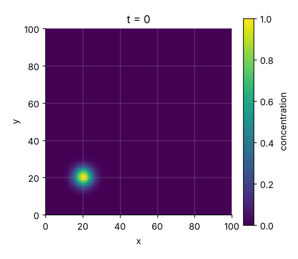
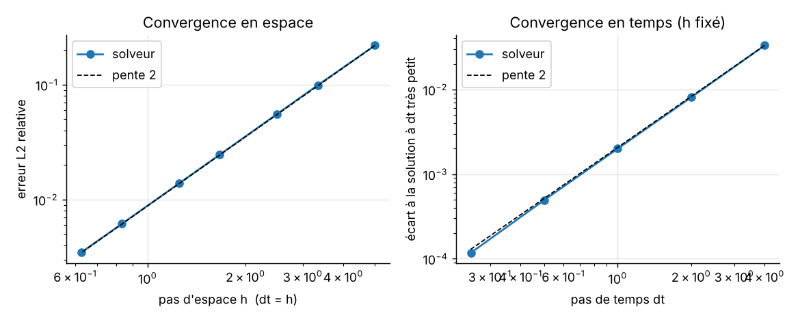
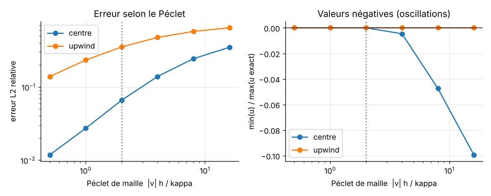
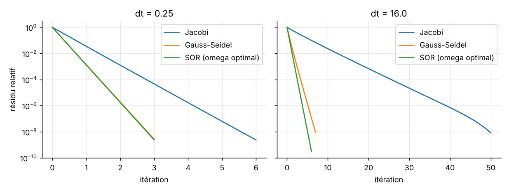
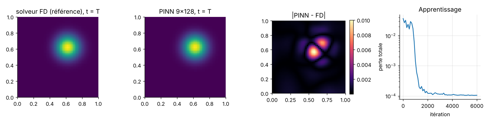
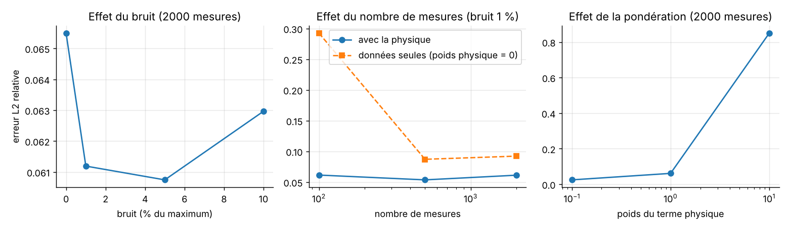
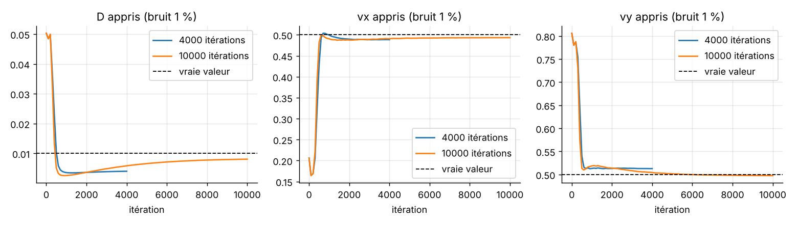
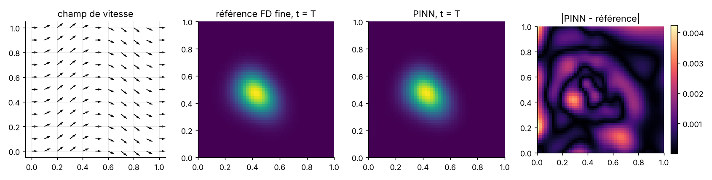

# Dispersion d'un polluant en 2D : du solveur aux différences finies au PINN

Ce dépôt simule la dispersion d'une tache de polluant dans un domaine 2D, sous l'effet d'un courant
(advection) et du mélange (diffusion) :

```
du/dt + v . grad(u) = kappa * laplacien(u)
```

Le projet va du modèle mathématique à son apprentissage par un réseau de neurones : un solveur aux
différences finies validé contre une solution exacte, une comparaison des méthodes de résolution des
systèmes linéaires creux (LU, Jacobi, Gauss-Seidel, SOR), puis un réseau de neurones informé par la physique
(PINN) confronté au solveur, y compris pour retrouver des paramètres physiques à partir de mesures bruitées.

Tout tourne sur CPU, sans GPU et sans données extérieures : tout est simulé.



## En bref

- Le solveur (Crank-Nicolson, matrices creuses) converge à l'ordre 2 en espace et en temps, et conserve la
  masse à 0,02 % près.
- Sur ce problème, une LU creuse factorisée une seule fois bat Jacobi, Gauss-Seidel et SOR dès que la grille
  dépasse quelques milliers d'inconnues. Parmi les méthodes itératives, SOR avec le bon omega est la meilleure.
- Le PINN reproduit la solution (environ 0,5 % d'erreur par rapport à la solution exacte pour le grand
  réseau), mais **n'est pas plus rapide** que le solveur sur ce cas : l'intérêt est ailleurs (voir plus bas).
- Avec peu de mesures (100), le terme physique fait passer l'erreur de 29 % à 6 %.
- En problème inverse, le PINN retrouve la vitesse du courant à quelques pour cent près (2000 mesures). Le
  coefficient de diffusion est beaucoup plus difficile à retrouver : 19 % d'erreur après 10 000 itérations.

## Contenu du dépôt

```
dispersion/
  modele.py              paramètres, condition initiale, solution exacte
  solveur.py             schéma de Crank-Nicolson sur matrices creuses (CSR)
  solveurs_lineaires.py  LU, Jacobi, Gauss-Seidel, SOR, rayon spectral
  pinn.py                PINN en PyTorch (direct et inverse)
  outils.py              figures et sauvegarde des chiffres
experiences/
  01_validation_solveur.py       convergence, masse, nombre de Péclet, GIF
  02_solveurs_lineaires.py       comparaison des solveurs linéaires
  03_pinn.py                     PINN : cas du papier, sensibilité, inverse, vitesse non uniforme
tests/                   12 tests (pytest)
resultats/               figures et chiffres.json (les chiffres de ce README en viennent)
media/                   animation
```

## Lancer

```bash
python -m venv .venv && source .venv/bin/activate      # sous Windows : .venv\Scripts\activate
pip install -r requirements.txt

python -m pytest tests                          # quelques secondes
python experiences/01_validation_solveur.py     # ~10 s
python experiences/02_solveurs_lineaires.py     # ~15 s
python experiences/03_pinn.py papier            # ~16 min sur un cœur CPU (réseau 9x128, 6000 itérations)
python experiences/03_pinn.py etudes            # ~30 min (nombreux entraînements de petits réseaux)
python experiences/03_pinn.py inverse_variantes # ~10 min
python experiences/03_pinn.py figures           # refait les figures à partir des résultats enregistrés
```

Les entraînements déjà faits sont enregistrés dans `resultats/pinn/` et ne sont pas refaits.

## Résultats

### 1. Le solveur

Schéma de Crank-Nicolson en temps, différences centrées en espace, Dirichlet (u = 0) à l'ouest et au sud,
Neumann à l'est et au nord. Comparaison avec la solution exacte de la gaussienne
(`u = sigma²/(sigma²+4 kappa t) · exp(-r²/(sigma²+4 kappa t))`, avec r mesuré depuis le centre qui se déplace
à la vitesse v).



- Ordre observé : **2,00** en espace (avec dt = h) et **2,03** en temps (écart à une solution à dt très
  petit sur la même grille).
- Masse entre 99,98 % et 100 % de la masse exacte (la petite perte vient sans doute de la queue de la
  gaussienne qui sort par les bords).

**Choix du schéma d'advection.** Le nombre de Péclet de maille `Pe = |v| h / kappa` compare l'advection à la
diffusion sur une maille. Au-dessus de 2, le schéma centré oscille ; l'upwind ne le fait jamais mais lisse
beaucoup (diffusion numérique).



| Pe | 0,5 | 1 | 2 | 4 | 8 | 16 |
|---|---|---|---|---|---|---|
| erreur centré | 0,012 | 0,027 | 0,066 | 0,139 | 0,244 | 0,349 |
| erreur upwind | 0,139 | 0,233 | 0,353 | 0,476 | 0,576 | 0,644 |
| min(u) centré / max | 0 | 0 | 0 | -0,005 | -0,048 | -0,099 |

Avec les paramètres par défaut, Pe vaut 0,9 sur la grille 61×61 (1,85 sur la grille 31×31, juste sous la
limite de 2) : le centré est le bon choix. C'est le même constat que dans mon projet 1D
sur Upwind, Lax-Friedrichs et Lax-Wendroff : l'ordre 1 diffuse, l'ordre 2 peut osciller.

### 2. Les solveurs linéaires

À chaque pas de temps il faut résoudre `A u_new = B u_old`. `A` est creuse (5 diagonales, environ 5 valeurs
non nulles par ligne). Le terme `I/dt` est sur sa diagonale : plus dt est grand, moins la diagonale domine.
Quand le Péclet est ≤ 2, la somme des termes hors diagonale sur la diagonale vaut
`1 − (1/dt)/diagonale`, strictement inférieure à 1, donc Jacobi converge. J'ai vérifié que la valeur mesurée
correspond à cette formule pour tous les dt testés.

Grille 31×31, départ à zéro, tolérance 1e-8 :

| dt | dominance | rho Jacobi | rho Gauss-Seidel | omega optimal | itérations J / GS / SOR |
|---|---|---|---|---|---|
| 0,05 | 0,008 | 0,0030 | < 1e-4 | 1,00 | 4 / 3 / 3 |
| 0,25 | 0,039 | 0,015 | 0,0002 | 1,00 | 6 / 3 / 3 |
| 1 | 0,139 | 0,052 | 0,0027 | 1,00 | 10 / 4 / 4 |
| 4 | 0,393 | 0,148 | 0,022 | 1,01 | 20 / 5 / 5 |
| 16 | 0,722 | 0,271 | 0,074 | 1,02 | 50 / 7 / 6 |



Deux choses que j'ai apprises en chemin :

- **`rho_GS = rho_J²`** (matrice à 5 points en numérotation naturelle), ce qui donne l'omega optimal de
  Young `2/(1+sqrt(1-rho_J²))`. C'est vérifié dans les tests.
- **Le calcul dense des valeurs propres est faux ici.** Avec de l'advection, la matrice d'itération de
  Jacobi est très non normale et `np.linalg.eigvals` donne 0,371 pour dt = 16, alors que la bonne valeur
  est 0,271 (méthode des puissances, qui coïncide avec la racine du rayon spectral de Gauss-Seidel).
  J'ai gardé les deux fonctions (`rayon_spectral` et `rayon_spectral_dense`).
  Pour Jacobi, il faut 50 itérations pour gagner 8 décades alors que rho = 0,27 en prévoirait environ 14 :
  le rayon spectral ne décrit que le comportement asymptotique, pas ce qui se passe au début.

Simulation complète jusqu'à T = 20 (dt = h, tolérance 1e-10, démarrage à chaud sur le pas précédent) :

| n inconnues | 1 681 | 6 561 | 14 641 | 25 921 |
|---|---|---|---|---|
| LU creuse (temps) | 0,007 s | 0,034 s | 0,095 s | 0,23 s |
| Jacobi | 0,007 s | 0,046 s | 0,24 s | 0,68 s |
| Gauss-Seidel | 0,007 s | 0,054 s | 0,26 s | 0,60 s |
| SOR (omega de Young) | 0,007 s | 0,046 s | 0,19 s | 0,42 s |
| itérations par pas, J / GS / SOR | 24 / 10 / 8 | 39 / 18 / 14 | 53 / 26 / 17 | 67 / 33 / 20 |

Ces temps viennent d'une seule exécution sur une petite machine : ils donnent un ordre de grandeur, pas
plus. Sur un seul pas de temps, la LU creuse prend 3,4 ms pour n = 1 681 contre 84 ms pour `np.linalg.solve`
sur la matrice dense, et 17 ms contre 2,96 s pour n = 6 561. En mémoire, la matrice CSR de la plus grande
grille pèse 1,6 Mo contre 5,4 Go en dense.

### 3. Le PINN

Le cadre est celui du papier de Battina et al. (2025) étudié en groupe : carré unité, v = (0,5 ; 0,5),
D = 0,01, T = 0,25. Le papier ne donne pas tous les détails : j'ai choisi une gaussienne de largeur 0,1
centrée en (0,5 ; 0,5), 2000 mesures tirées au hasard dans le résultat du solveur (grille 51×51, 100 pas de
temps) avec 1 % de bruit, et un learning rate qui décroît jusqu'à 1 % de sa valeur de départ.
**Mes chiffres ne sont donc pas comparables à ceux du papier (8,25 %).**

**Le réseau du papier** : 9 couches de 128 neurones (132 737 paramètres), Adam, learning rate 6·10⁻³,
6000 itérations.



| erreur L2 relative, moyenne sur 11 instants | |
|---|---|
| PINN contre la solution exacte | 0,54 % |
| PINN contre le solveur FD | 1,16 % |
| solveur FD contre la solution exacte | 1,13 % |

Les 1,16 % contre le solveur sont donc surtout l'erreur du solveur lui-même : le PINN est plus proche de la
solution exacte que la référence qui l'a nourri.

**Coût.** Entraînement : 952 s sur un cœur CPU. Prédire un champ complet (51×51) à un instant donné : 9,3 ms.
Le solveur FD calcule les 100 pas de temps en 25 ms. Sur ce problème, le PINN n'apporte donc pas de gain de
vitesse. Notre présentation disait « moins d'une milliseconde pour une trajectoire » une fois le réseau entraîné
sur GPU. Je n'ai pas de GPU ici et ce n'est pas la même quantité (je mesure un champ complet), donc je ne
peux ni confirmer ni infirmer cette phrase. Sur CPU, je mesure 9 ms pour un champ complet.

**Sensibilité** (réseau plus petit, 5 couches de 64, 3000 itérations, **une seule graine**, donc les petits
écarts ne sont pas significatifs).



- *Bruit* : pas d'effet visible (6,6 % sans bruit, 6,1 % à 1 %, 6,1 % à 5 %, 6,3 % à 10 %). L'erreur est
  limitée par la taille du réseau et la durée d'entraînement, pas par le bruit.
- *Nombre de mesures* : avec le terme physique, 6,1 % (100 mesures), 5,4 % (500), 6,1 % (2000). Sans le
  terme physique : 29,2 %, 8,7 % et 9,2 %. C'est là que le PINN apporte quelque chose : avec 100 points, la
  physique fait passer l'erreur de 29 % à 6 %.
- *Pondération* : un poids de 0,1 sur le terme physique donne 2,5 %, le poids de 1 donne 6,1 % et le poids
  de 10 fait échouer l'entraînement (85 %). Mon hypothèse, que je n'ai pas vérifiée : quand la physique
  domine, le réseau tend vers la solution triviale u = 0, qui annule le résidu.

**Problème inverse.** On suppose connues la condition initiale et les bords, et on apprend D et v en même
temps que le réseau, en partant de D = 0,05 et v = (0,2 ; 0,8) (vrai : D = 0,01 et v = (0,5 ; 0,5)).

| cas | D | vx | vy |
|---|---|---|---|
| 4000 itérations, sans bruit | 0,0041 | 0,486 | 0,510 |
| 4000 itérations, bruit 1 % | 0,0040 | 0,488 | 0,513 |
| 4000 itérations, bruit 5 % | 0,0038 | 0,495 | 0,519 |
| 4000 itérations, bruit 10 % | 0,0036 | 0,504 | 0,527 |
| 4000 itérations, 200 mesures, bruit 5 % | 0,0035 | 0,510 | 0,446 |
| **10 000 itérations, bruit 1 %** | **0,0081** | **0,493** | **0,498** |
| 8000 itérations, lr 2·10⁻³, bruit 1 % | 0,0085 | 0,494 | 0,496 |



Avec 2000 mesures, la vitesse est retrouvée à quelques pour cent près (jusqu'à 5 % d'erreur sur vy avec 10 %
de bruit), mais avec seulement 200 mesures vy est à 11 % de la vraie valeur. D est le point faible : après 4000
itérations il est sous-estimé de 60 %, et ce n'est pas le bruit qui est en cause (même sans bruit : 0,0041).
En laissant tourner 10 000 itérations, il remonte à 0,0081, mais la courbe n'est pas encore plate.
Je pense que c'est parce que la diffusion agit peu sur la solution à ces échelles de temps, alors que le
déplacement se voit tout de suite, mais je ne l'ai pas testé.

**Vitesse non uniforme** : `v = (0,5 ; 0,4 sin(2 pi x))`, où il n'y a plus de solution exacte. La référence est
un solveur FD sur une grille 201×201 ; le solveur 51×51 qui fournit les mesures s'en écarte de 1,30 %.
Le PINN (6 couches de 80 neurones) est à 1,58 % de la référence fine.



## Limites

- Tout est synthétique : aucune donnée réelle, donc rien ne dit comment ça se comporte sur de vraies mesures
  (bouées, satellite), qui est précisément la limite que signale le papier.
- Une seule graine pour tous les entraînements de PINN.
- Le modèle est volontairement simple : 2D, D constant, pas de réaction chimique, pas de côtes, pas de vent.
- Dans le solveur, les bords sont Dirichlet à l'ouest et au sud et Neumann à l'est et au nord, alors que le
  PINN impose u = 0 partout. Cela ne change pas grand-chose ici car la tache reste loin des bords.
- Tout est calculé sur CPU, et les temps sont indicatifs.
- Les études du solveur et du PINN n'ont pas les mêmes paramètres (domaine de 100 contre 1) : les premières
  utilisent des valeurs d'ordre de grandeur côtier, les secondes reprennent celles du papier.

## Références

1. K. Battina, P. D. Joshi, R. A. Dandekar, R. Dandekar, S. Panat, *Physical informed neural networks for
   modeling ocean pollutant*, arXiv:2507.08834, 2025.
2. M. Raissi, P. Perdikaris, G. E. Karniadakis, *Physics-informed neural networks*, Journal of Computational
   Physics 378, 2019.
3. Cours de Polytech Nice Sophia / Université Côte d'Azur : équations de transport 1D (A. Habbal) et méthodes
   itératives pour les systèmes linéaires creux (M. Elsawy, J.-L. Bouchot).

Étude du papier [1] faite en groupe avec Jibril Khay et Issa Nour (Université Côte d'Azur, mai 2026).

*Firas Ghedir*
